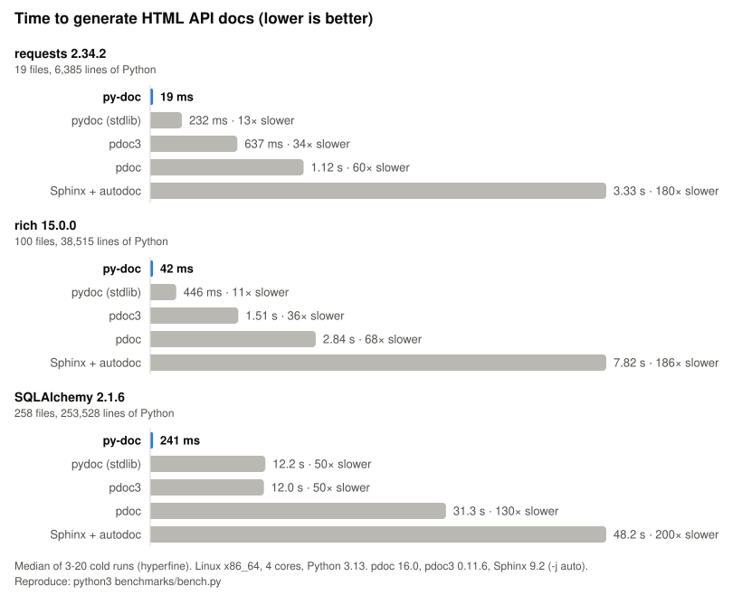

# py-doc

A lightweight and fast documentation tool for Python codebases, powered by Rust.

py-doc reads your `.py` files, never imports or runs them, and writes a static site: one page per module, a searchable index, and three switchable layouts. The theme is built into the binary, so generation works offline.

<p align="center"></p>

py-doc documents all 253,000 lines of SQLAlchemy in about a third of a second: 45x faster than `pydoc` and `pdoc3`, 115x faster than `pdoc`, and 180x faster than Sphinx with autodoc. See [Benchmarks](#benchmarks) for how this was measured.

## Table of Contents

* [Installation](#installation)
* [Usage](#usage)
* [Writing docs](#writing-docs)
* [The generated site](#the-generated-site)
* [Custom templates](#custom-templates)
* [Benchmarks](#benchmarks)
* [Development](#development)
* [Troubleshooting](#troubleshooting)

---

## Installation

Choose the installation method that fits your environment.

### Option A: One-Line Script Installer (Easiest)

You do not need Cargo or Rust installed for this. The script downloads the pre-compiled binary for your platform, verifies its SHA-256 checksum when the release publishes one, and installs it.

* **macOS / Linux (Bash/Zsh):** installs to `/usr/local/bin`
```bash
curl -fsSL https://raw.githubusercontent.com/kura120/py-doc/master/scripts/install.sh | sh
```

* **Windows (PowerShell):** installs to `%USERPROFILE%\.cargo\bin`
```powershell
irm https://raw.githubusercontent.com/kura120/py-doc/master/scripts/install.ps1 | iex
```

### Option B: Fast Binary Installer (cargo-binstall)

If you have Cargo but want to avoid compile times, install the pre-compiled binary with `cargo-binstall`. py-doc is not published on crates.io, so point it at the repository:

```bash
# Install cargo-binstall if you don't have it
cargo install cargo-binstall

cargo binstall --git https://github.com/kura120/py-doc py-doc
```

### Option C: Build from Source

```bash
git clone https://github.com/kura120/py-doc.git
cd py-doc
cargo install --path .
```

---

## Usage

Run `py-doc` against a Python project directory or a single `.py` file:

```bash
py-doc --src path/to/project --out ./docs --name project-name
```

Run `py-doc` with no arguments in a terminal to use the interactive setup wizard instead. In the wizard, Tab moves between fields, the arrow keys browse folders in path fields, and Enter on the last row generates the site.

### Options

| Flag | Meaning |
| --- | --- |
| `-s`, `--src <PATH>` | Project directory, or a single `.py` file. Required. |
| `-o`, `--out <DIR>` | Where the site is written. Required. |
| `-n`, `--name <NAME>` | Package name shown in the docs. Required. |
| `--doc-version <VERSION>` | Your project's version, shown in the sidebar. Default `1.0.0`. |
| `--layout <classic\|minimal\|modern>` | Layout the site opens with. Default `classic`. |
| `--theme <auto\|dark\|light\|slate>` | Color theme the site opens with. `auto` (default) follows the reader's system setting. |
| `-e`, `--exclude <NAME>` | Skip a file or directory, by name or by path relative to `--src`. Repeatable. |
| `--source-url <URL>` | Base URL of a browsable copy of the sources. Turns each symbol's `file:line` reference into a link. |
| `-t`, `--templates <DIR>` | Directory with replacement theme files. See [Custom templates](#custom-templates). |
| `--strict` | Exit with an error if a file fails to parse, or a macro, image or doc-link cannot be resolved. Useful in CI. |
| `--clean` | Remove files that an earlier run wrote to `--out` and this run no longer produces, such as pages for deleted modules. |
| `--include-private` | Also document private names and modules. See [Public API](#public-api). |
| `-V`, `--version` | Print the py-doc version. |
| `-h`, `--help` | Print help. |

> **Changed in this release:** `-v` / `--version <VERSION>` used to set the version shown in the docs. That is now `--doc-version`, and `--version` reports the tool's own version.

### What is scanned

Every `.py` file under `--src` is documented, except:

* `__main__.py` files;
* hidden directories (names starting with `.`, such as `.venv` and `.git`);
* `__pycache__`, `venv`, `node_modules`, `site-packages`, `build`, `dist`, `htmlcov`, `__pypackages__` and `*.egg-info` directories;
* anything named with `--exclude`.

Files with syntax errors are reported and skipped; the rest of the site is still generated.

### Public API

By default only the public API is documented, the way pdoc does it:

* If a module defines `__all__`, only the names listed there are shown. A listed `_name` is shown too. `__all__` must be a literal list or tuple of strings; `+=`, `.extend(...)` and `.append(...)` with literals are followed. If it is built any other way, it is ignored.
* Otherwise, names starting with `_` are hidden. Dunder methods such as `__init__` and `__call__` are always shown.
* A module whose name starts with `_` is hidden, and so is everything inside a package whose name starts with `_`.

Hidden items get no page and do not appear in the navigation or search. A `#pd-doc-link` to one is reported as a warning instead of being linked. Pass `--include-private` to document everything.

### Keeping the output folder tidy

Each run records the files it wrote in `.py-doc-manifest` inside `--out`. `--clean` deletes files listed there that the current run did not produce, and removes folders left empty. Anything py-doc did not write, such as a `CNAME` file or hand-written pages, is never touched. An output folder from before this feature has no manifest, so its old files are not removed.

### Linking to source

```bash
py-doc --src . --out docs --name myproject \
  --source-url https://github.com/me/myproject/blob/main
```

---

## Writing docs

Docstrings are rendered as Markdown, including tables, strikethrough and task lists. Python code blocks are syntax-highlighted at build time.

### Macros

Put a macro on its own line inside any docstring.

| Macro | Effect |
| --- | --- |
| `#pd-note: text` | A highlighted note box. The text may use inline Markdown. |
| `#pd-warning: text` | A highlighted warning box. The text may use inline Markdown. |
| `#pd-doc-link: target` | A "See Reference" link to a module, class, function or method. |
| `#pd-image: path` | An image. The path is relative to `--src` and must stay inside it. |
| `#pd-code` | Starts a Python code block that ends at the next line containing only ```` ``` ````. For another language, name it: `#pd-code json`. |
| `#pd-write` | As the first line of a module docstring, in a module with no classes or functions: renders the module as a plain document page. |
| `#pd-z-index: N` | In a module docstring: sort position in the navigation. Lower numbers come first. |

`#pd-doc-link` targets are dotted paths. All of these work, as long as they identify exactly one thing:

```text
#pd-doc-link: core.engine                 a module
#pd-doc-link: core.engine.Engine          a class
#pd-doc-link: core.engine.Engine.run      a method
#pd-doc-link: helpers.slugify             a unique trailing path is enough
#pd-doc-link: Engine                      a bare name, if only one module defines it
```

A target that cannot be found is shown as "(not found)" and reported as a warning. So are a misspelled macro, a missing image and a `#pd-code` block that is never closed. Macro-looking lines inside an ordinary fenced code block are left as text.

### A documentation-only page

```python
"""#pd-write
#pd-z-index: 1
# Getting Started

Welcome to the project.

#pd-note: Requires Python 3.10 or newer.
#pd-doc-link: core.engine.Engine
"""
```

### Ordering folders

Prefix a folder name with digits and an underscore to control its position. The prefix sets the order and is not shown: `01_getting_started/` appears first, as "getting_started". Folders without a prefix follow, largest first.

A folder's `__init__.py` docstring becomes the folder's description, and the root `__init__.py` docstring is shown on the landing page.

---

## The generated site

* **Layouts:** Classic, Minimal and Modern, switchable from the sidebar. Each has a light and a dark palette; Classic also has Slate.
* **Theme:** follows the reader's system setting by default. The button at the top of the sidebar flips between light and dark, and the choice is remembered.
* **Search:** press `/` or `Ctrl+K`, type, move with the arrow keys, open with Enter, close with Esc. Search covers names and the first line of each docstring.
* **Module pages:** signatures with defaults and annotations as written, class bases, `property` / `static` / `classmethod` / `abstract` badges, a `file:line` reference per symbol, and an "On this page" outline on wide screens.

The output is plain static files. Open `index.html` directly or host the folder anywhere.

---

## Custom templates

`--templates <DIR>` replaces parts of the bundled theme. Any of these files found in the directory is used instead of the built-in one; the rest fall back to the bundled theme:

```text
base.html  index.html  module.html  document.html  sidebar.html  style.css  app.js
```

The HTML files are [Tera](https://keats.github.io/tera/) templates. The bundled versions in [`assets/`](assets) are the reference for the variables available.

### Overriding one block

You do not have to copy a whole page to change part of it. The bundled templates are also available under the `py-doc/` prefix, so a custom template can extend the one it replaces and override only the blocks it changes. Everything else keeps the bundled default.

This `module.html` gives every module page a new header and leaves the rest of the page alone:

```html



<h1 class="module-title">{{ display_module_name }} <small>{{ package.name }} {{ version }}</small></h1>

```

Use `{{ super() }}` inside a block to keep the bundled content and add to it:

```html
{{ super() }}<script src="{{ root_path }}extra.js" defer></script>
```

`index.html`, `module.html` and `document.html` all extend `base.html`, which holds the page skeleton. Its blocks are:

| Block | Holds |
| --- | --- |
| `head` | Everything inside `<head>`, including the blocks below it |
| `title` | The text of `<title>` |
| `description` | The `content` of the description `<meta>` tag |
| `stylesheets` | The `style.css` link |
| `body_attributes` | Extra attributes on `<body>` |
| `sidebar` | The `sidebar.html` include and the resize handle |
| `header` | The top of the page: breadcrumb and title |
| `content` | The page body |
| `outline` | The "On this page" panel (module pages only) |
| `footer` | Empty by default; shown after the page body |
| `scripts` | The script tags at the end of `<body>` |

`module.html` also splits `content` into `module_docstring`, `classes` and `functions`.

A custom `base.html` that extends `py-doc/base.html` changes every page at once, for example to add a footer to the whole site.

Any other `*.html` file in the directory, including ones in subfolders, can be included or extended by name: ``. Whole-file replacements still work: a template that does not use `extends` is rendered as it is.

---

## Benchmarks

Each tool generated HTML API docs for three packages from PyPI. Every run started from an empty output folder, and the figure is the median of 3 to 20 runs measured with [hyperfine](https://github.com/sharkdp/hyperfine) on a 4-core Linux machine.

| Package | Size | py-doc | pydoc | pdoc3 | pdoc | Sphinx + autodoc |
| --- | --- | ---: | ---: | ---: | ---: | ---: |
| requests 2.34.2 | 19 files, 6.4k lines | **20 ms** | 305 ms | 868 ms | 1.50 s | 4.27 s |
| rich 15.0.0 | 100 files, 38.5k lines | **44 ms** | 571 ms | 1.95 s | 3.88 s | 10.8 s |
| SQLAlchemy 2.1.6 | 258 files, 254k lines | **344 ms** | 15.9 s | 15.5 s | 39.7 s | 62.6 s |
| SQLAlchemy, peak memory | | **94 MB** | 146 MB | 133 MB | 1,077 MB | 523 MB |

**Why the gap is so large.** pydoc, pdoc, pdoc3 and Sphinx's autodoc all *import* your package and inspect the live objects, so they pay for Python startup, every import side effect and runtime introspection. py-doc parses the source with Ruff's Rust parser instead and renders pages in parallel on every core.

**What that trade-off costs.** Import-based tools see things a parser cannot, such as attributes created at runtime, members inherited from other packages, and docstrings assigned with `__doc__ = ...`. Because py-doc never imports, it also works without your dependencies installed and never runs your code.

**Fairness.** Every tool used the same Python and the same package versions. Sphinx ran with `-j auto`, so it used all cores the same way py-doc does. Import-based tools were given only modules that import cleanly on the test machine; py-doc parsed every file, so it did slightly more work.

To reproduce, run `cargo build --release && python3 benchmarks/bench.py`, then `python3 benchmarks/make_chart.py` to redraw the chart. Raw numbers are in [`benchmarks/results.json`](benchmarks/results.json).

---

## Development

```bash
cargo test                                   # unit tests and end-to-end tests against tests/fixtures
cargo clippy --all-targets -- -D warnings
cargo fmt --check
```

Release builds are made with `scripts/build.sh [TARGET]` or `scripts/build.ps1 [-Target TARGET]`. Pushing a `v*` tag that matches the version in `Cargo.toml` builds and publishes binaries with SHA-256 checksums.

UPX compression is available with `--upx` / `-Upx` for local builds. Published binaries are not packed: the download is already compressed, and packed executables are unsupported on macOS and often flagged by antivirus tools on Windows.

---

## Troubleshooting

### 'py-doc' is not recognized as a command

If you chose Option C (or your script path environment variable is missing), your shell cannot locate the executable. You must add Cargo's binary directory to your PATH.

* **Windows (PowerShell):**
```powershell
[Environment]::SetEnvironmentVariable("Path", "$env:Path;$env:USERPROFILE\.cargo\bin", "User")
```

* **macOS / Linux:**
```bash
echo 'export PATH="$HOME/.cargo/bin:$PATH"' >> ~/.zshrc
source ~/.zshrc
```

### Dependency Conflicts during Local Compilation

If you see a compiler error stating `the trait bound 'CompactString: GetSize' is not satisfied` during source installations, run:

```powershell
cargo clean
cargo install --path .
```

This forces Cargo to respect the exact version constraint specified in the manifest.
